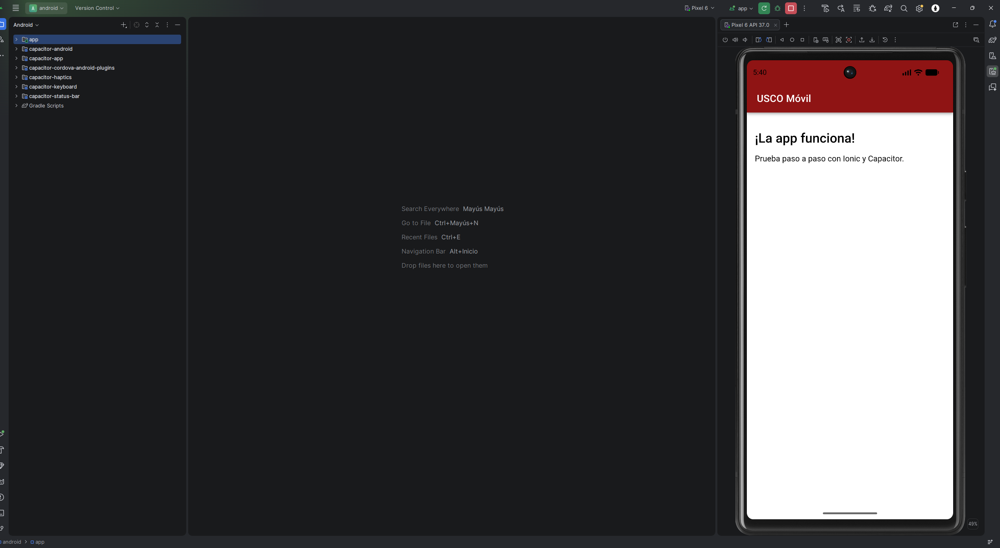

# USCO Móvil

**USCO Móvil** es una aplicación de prueba desarrollada con **Ionic + Angular (Standalone)** y empaquetada con **Capacitor** para la plataforma Android. Este proyecto forma parte de las actividades académicas de la **Universidad Surcolombiana**, en la asignatura **Programación de Dispositivos Móviles (Unidad 4)**.

---

## Requisitos Previos

Para poder compilar, probar y empaquetar este proyecto, se requiere tener instalado en el equipo:
- **Node.js** (y npm)
- **Ionic CLI** (`npm install -g @ionic/cli`)
- **Android Studio** con el SDK de Android instalado y un emulador configurado (AVD)
- **JDK** (Java Development Kit, compatible con Gradle)

---

## Estructura del Proyecto

Las carpetas y archivos más importantes del proyecto son:
- `src/`: Código fuente de la aplicación Angular (páginas, componentes, rutas).
- `www/`: Archivos web compilados de la aplicación Ionic.
- `android/`: Proyecto nativo de Android generado por Capacitor.
- `release/`: Carpeta que contiene el APK compilado (`app-debug.apk`).
- `capturas/`: Carpeta destinada a almacenar las capturas de pantalla de evidencia (contiene `.gitkeep`).
- `capacitor.config.ts`: Archivo de configuración global de Capacitor.

---

## Comandos Utilizados

A continuación se detallan los comandos utilizados en orden cronológico durante el desarrollo:

1. `ionic start appNativa blank --type=angular --no-link`
   - *Crea un nuevo proyecto Ionic con Angular utilizando una plantilla en blanco.*
2. `cd appNativa`
   - *Entra en la carpeta del proyecto recién creado.*
3. Edición de `src/app/home/home.page.html`
   - *Modifica la vista principal con la interfaz de usuario personalizada.*
4. `ionic build`
   - *Compila la aplicación web de Angular generando la carpeta `www`.*
5. `npm install @capacitor/android`
   - *Instala la plataforma nativa de Android para Capacitor.*
6. `npx cap add android`
   - *Agrega el proyecto nativo Android basado en la configuración de Capacitor.*
7. `npx cap sync android`
   - *Sincroniza los cambios web compilados y los plugins con el proyecto Android.*
8. `npx cap open android`
   - *Abre el proyecto nativo en Android Studio.*

---

## Configuración de Capacitor

En el archivo [capacitor.config.ts](file:///C:/Users/milox/appNativa/capacitor.config.ts) se estableció la siguiente configuración:

```ts
import type { CapacitorConfig } from '@capacitor/cli';

const config: CapacitorConfig = {
  appId: 'co.edu.usco.appnativa',
  appName: 'USCO Móvil',
  webDir: 'www'
};

export default config;
```

---

## Cómo Ejecutar en el Emulador

1. Abre **Android Studio** (o ejecuta `npx cap open android`).
2. Espera a que finalice el **Gradle Sync** automático.
3. Selecciona un dispositivo virtual (Emulador AVD) en la barra superior.
4. Haz clic en el botón **Run** (ícono de Play verde ▶) para compilar y ejecutar la app en el emulador.

---

## Cómo Generar el APK

1. En Android Studio, ve al menú superior: **Build > Build Bundle(s) / APK(s) > Build APK(s)**.
2. Al finalizar, el APK se generará en la ruta:
   `android/app/build/outputs/apk/debug/app-debug.apk`
3. Se copió automáticamente una copia a la carpeta `release/` del proyecto para facilitar su entrega.

---

## Cómo Instalar en un Celular Propios

1. Transfiere el archivo `release/app-debug.apk` a tu dispositivo Android (por cable USB, correo o nube).
2. En tu celular, abre el archivo APK.
3. Si el sistema lo solicita, habilita la opción de **Instalar aplicaciones de origen desconocido** (Unknown sources) para este explorador de archivos.
4. Confirma la instalación y abre la app **USCO Móvil** desde el cajón de aplicaciones.

---

## Regla de Oro

> **¡Importante!** Tras cada cambio de código en TypeScript, HTML o CSS, debes repetir los siguientes comandos para que los cambios se reflejen en la app de Android:
> ```bash
> ionic build
> npx cap sync android
> ```

---

## Evidencia



---

## Problemas Encontrados y Soluciones

1. **Error: "Could not find the android platform"**
   - *Causa:* No se había instalado la dependencia nativa de Capacitor para Android.
   - *Solución:* Se ejecutó `npm install @capacitor/android` y posteriormente `npx cap add android`.
2. **Aviso de incompatibilidad Gradle JVM 25 con Gradle 8.14.3**
   - *Causa:* La versión del JDK por defecto era la 25, generando conflictos de reflexión interna en AGP.
   - *Solución:* Se configuró la variable de entorno `JAVA_HOME` apuntando al JDK 21 / JBR adecuado y se resolvieron conflictos de rutas de entorno (`ANDROID_PREFS_ROOT`).

---

## Autor

- **Andres Camilo Reina Diaz** 
